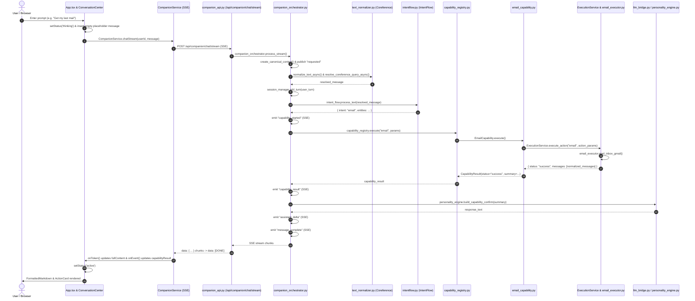
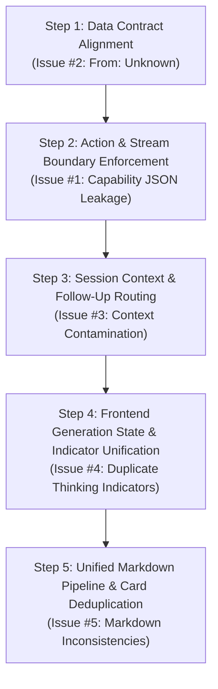

# MITRA PHASE 2 — COMMUNICATION UI + AGENT RUNTIME CLEANUP
# STEP 1: PRODUCTION ISSUE AUDIT REPORT

**Document ID:** `DEP-AUDIT-PHASE2-STEP1`  
**Date:** October 16, 2026  
**Auditor / Engineering Lead:** AI Engineering Pair (MITRA Team)  
**Baseline Git Commit:** `4444285e34df07d7a6bcda223ffeb9ed058cccaa`  
**Repository:** `https://github.com/praj33/MITRA.git`  
**Branch:** `main` (clean working tree, in sync with `origin/main`)  
**Production URL:** `https://mitra.blackholeinfiverse.com`  
**Audit Scope:** 5 Identified Production Issues (Audit Only — Zero Code Modifications)

---

## 1. Executive Summary

This comprehensive audit investigates five critical production issues in MITRA's Communication UI and Agent Runtime:
1. **Internal Capability/Action JSON Leakage:** Raw action payloads (e.g. `{"action":"email.read",...}`) occasionally appear inside user-visible chat bubbles.
2. **`From: Unknown` in Email Results:** Sender identities for Gmail read/search operations resolve to `"Unknown"` despite valid Gmail accounts and tokens.
3. **Capability-Result / Context Contamination:** Multi-turn follow-ups (e.g., *"Get my last mail"* followed by *"Yes give me full content"*) fail to retain capability context and trigger unrelated web search / YouTube / Google Play media snippets.
4. **Duplicate Thinking / Typing Indicators:** Users see two concurrent pulsing indicators (an empty assistant message placeholder and a floating thinking widget) during active generation.
5. **Markdown Formatting Inconsistencies:** Capability results render with inconsistent headings, raw asterisks, double summary echo, and unparsed Markdown across `ConversationCard` and `ActionCard`.

### Audit Methodology
- **Codebase Source of Truth:** Direct, exhaustive inspection of `backend/app` and `frontend/frontend/src`.
- **Contract & Trace Analysis:** Traced the complete lifecycle from user DOM input through SSE streaming to UI presentation.
- **Verification Suites Executed:** 102 backend tests (100% pass) and 32 frontend tests (100% pass), plus successful frontend production build.
- **Observational Comparison:** Safe, read-only health checks against the live production environment.
- **Zero Modifications:** No application code was altered. Exactly this single audit document is added.

---

## 2. Current Git / Deployment Baseline

The local repository was verified prior to analysis:
- **Active Branch:** `main`
- **Current HEAD Commit:** `4444285e34df07d7a6bcda223ffeb9ed058cccaa`
- **Remote `origin/main`:** `4444285e34df07d7a6bcda223ffeb9ed058cccaa`
- **Working Tree State:** Completely clean (`git status` reports nothing to commit).
- **Match Confirmation:** Matches the expected Phase 1 handover closure baseline exactly.

```
$ git status
On branch main
Your branch is up to date with 'origin/main'.
nothing to commit, working tree clean

$ git rev-parse HEAD
4444285e34df07d7a6bcda223ffeb9ed058cccaa

$ git rev-parse origin/main
4444285e34df07d7a6bcda223ffeb9ed058cccaa
```

---

## 3. Current Agent Runtime Request Lifecycle



### Architectural Junctions & Responsibilities
| Component | File Path | Primary Function in Lifecycle |
|---|---|---|
| **Chat Stream Controller** | `frontend/frontend/src/App.tsx` | Manages message submission, placeholder insertion, abort controller, and SSE streaming handlers |
| **SSE Parser** | `frontend/frontend/src/services/companion.service.ts` | Splits incoming HTTP buffer into SSE lines, parses `data:` JSON payloads, classifies tokens vs events |
| **FastAPI Streaming Route** | `backend/app/api/companion_api.py` | Validates JWT user identity, sets up `text/event-stream` response, yields JSON strings terminated by `[DONE]` |
| **Companion Orchestrator** | `backend/app/companion/companion_orchestrator.py` | Central brain: manages session, coreference, intent mapping, safety check, capability execution, and event emission |
| **Coreference & Normalizer** | `backend/app/core/text_normalizer.py` | Corrects typos and resolves anaphoric references against recent conversation history |
| **Intent Classifier** | `backend/app/core/intentflow.py` | Keyword- and regex-based NLU mapping utterances to intent names |
| **Capability Registry** | `backend/app/companion/capability_registry.py` | Routes intent to registered capability classes |
| **Email Capability** | `backend/app/capabilities/email_capability.py` | Validates email parameters, builds summary strings, formats actions and confirmation cards |
| **Execution Service** | `backend/app/services/execution_service.py` | Bridges capabilities to concrete provider executors with governance enforcement |
| **Email Executor** | `backend/app/executors/email_executor.py` | Communicates directly with Gmail REST API via OAuth tokens, normalizes raw payloads |
| **Personality Engine** | `backend/app/companion/personality_engine.py` | Formulates companion system prompts, confirms capabilities, and governs tone |
| **LLM Bridge** | `backend/app/core/llm_bridge.py` | Connects to Groq/OpenAI providers with local fallback rules and web search synthesis |
| **Message Bubble View** | `frontend/frontend/src/components/cards/ConversationCard.tsx` | Renders individual messages, TTS trigger, inline confirmation cards, and action pills |
| **Markdown Primitive** | `frontend/frontend/src/components/primitives/FormattedMarkdown.tsx` | Renders sanitized GitHub Flavored Markdown with LaTeX and code highlighting |
| **Action Card Primitive** | `frontend/frontend/src/components/cards/ActionCard.tsx` | Renders capability execution status, data snippet table, and action trigger buttons |

---

## 4. Issue #1 — Internal Capability / Action JSON Leakage

### Status
**CONFIRMED (VULNERABILITY PRESENT)**

### Observed Phenomenon
Users observe raw JSON payloads such as:
```json
{"action":"email.read","parameters":{"count":1,"folder":"inbox"}}
```
rendered directly in the assistant's message bubble instead of a natural response.

### Evidence
1. **Frontend Fallback Token Emission (`companion.service.ts` L48–60):**
   ```typescript
   // Check if payload is a structured JSON event
   if (dataContent.startsWith('{') && dataContent.endsWith('}')) {
     try {
       const parsed = JSON.parse(dataContent);
       if (parsed && typeof parsed === 'object' && parsed.type) {
         return { type: 'event', event: parsed };
       }
     } catch {
       // Non-JSON falls through to plain token
     }
   }
   return { type: 'token', content: dataContent };
   ```
   *Analysis:* If a JSON object is emitted that has an `"action"` property rather than `"type"`, `parsed.type` evaluates to `undefined`. `parseSSELine` defaults to returning `{ type: 'token', content: dataContent }`.
2. **Blind Token Accumulation (`App.tsx` L317–322):**
   ```typescript
   (token: string) => {
     if (controller.signal.aborted) return;
     fullContent += token;
     updateMessage(assistantMsgId, { content: fullContent });
   }
   ```
   *Analysis:* Any token returned by `parseSSELine` is blindly concatenated into `fullContent` and rendered into the active chat bubble.
3. **LLM Prompting Without Tool Syntax Protection (`companion_orchestrator.py` L601–675 & `personality_engine.py` L132–139):**
   When intent classification fails to detect a capability and routes to `_stream_conversation`, the LLM is prompted with a list of capabilities and instructions like:
   *"When the user asks you to do something that matches a capability: 1. Confirm what you're about to do... 2. Execute via the capability system..."*
   Standard chat LLMs (such as Llama-3 or Mistral on Groq) frequently attempt to output function-call JSON blocks like `{"action": "email.read", ...}` when prompted in this manner.
4. **Direct Token Streaming Without Sanitization (`companion_orchestrator.py` L669–674):**
   Tokens from `llm_bridge.stream_llm_with_messages` are yielded directly as `assistant_delta` events with zero filtering for JSON structures.

### Root Cause
1. **Backend:** In `_stream_conversation`, LLM output tokens are streamed raw without detecting or buffering intermediate function-calling / tool-planning JSON strings.
2. **Frontend:** In `companion.service.ts`, `parseSSELine` treats any JSON object lacking a `type` field as plain text tokens rather than recognizing it as an internal action structure and suppressing it.

### Recommended Fix
- **Backend:** In `companion_orchestrator.py` / `personality_engine.py`, explicitly instruct the conversational stream prompt that capability actions can only be triggered by the orchestrator, and add a streaming buffer filter in `_stream_conversation` to discard or convert raw tool JSON into structured capability execution requests.
- **Frontend:** In `companion.service.ts` (`parseSSELine`), add an explicit guard:
  ```typescript
  if (parsed && typeof parsed === 'object' && (parsed.action || parsed.tool_call)) {
    return { type: 'ignore' }; // Do not leak internal action JSON into message text
  }
  ```

### Regression Risk
Low. Care must be taken so that legitimate user requests for JSON code snippets (e.g., "give me a sample JSON payload for an email") are not suppressed when wrapped in markdown code fences (` ```json `).

---

## 5. Issue #2 — `From: Unknown` in Email Results

### Status
**CONFIRMED (DEFINITIVE CONTRACT BUG)**

### Observed Phenomenon
When reading or searching emails via natural language (e.g. *"Check my inbox"* or *"Find emails from Alex"*), MITRA returns:
```
1. **From:** Unknown
   **Subject:** Q3 Strategy Review
   **Date:** 
   **Snippet:** Please review the attached deck...
```
The sender is displayed as `"Unknown"` and the date is blank, even when the message contains valid headers.

### Evidence
1. **Email Executor Normalization (`email_executor.py` L352–363):**
   ```python
   norm = {
       "id": msg_id,
       "thread_id": thread_id,
       "sender": sender,         # <--- Canonical key is "sender"
       "recipient": recipient,
       "subject": subject,
       "snippet": snippet,
       "content": content,
       "timestamp": timestamp,   # <--- Canonical key is "timestamp"
       "has_attachments": has_attachments,
       "labels": labels,
   }
   ```
2. **Email Capability Extraction (`email_capability.py` L146–152 & L160–166):**
   ```python
   for idx, m in enumerate(msgs[:10], 1):
       snd = m.get("from") or "Unknown"      # <--- Looks up "from"!
       sbj = m.get("subject") or "(No Subject)"
       dt = m.get("date") or ""              # <--- Looks up "date"!
       snp = m.get("snippet") or ""
       lines.append(f"{idx}. **From:** {snd}\n   **Subject:** {sbj}\n   **Date:** {dt}\n   **Snippet:** {snp}")
   ```
   *Analysis:* Because `m` produced by `email_executor.py` has key `"sender"`, `m.get("from")` evaluates to `None`. The Python `or` operator immediately falls back to `"Unknown"`. Similarly, `m.get("date")` evaluates to `None`, making the date blank.
3. **Empty Details Fallback Stubs (`email_executor.py` L669, L682, L803, L816):**
   In cases where batch details fetch fails or returns partial metadata, `email_executor.py` populates:
   ```python
   "sender": "",
   "recipient": "",
   "subject": "",
   ```
   which again does not contain a `"from"` key.

### Root Cause
Direct contract mismatch between `email_executor.py` (which produces `{ "sender": ..., "timestamp": ... }`) and `email_capability.py` (which expects `{ "from": ..., "date": ... }`). Because of this dictionary key divergence, every single email returned by `READ_MESSAGES` and `SEARCH_MESSAGES` evaluates `m.get("from")` to `None` and displays `"From: Unknown"`.

### Recommended Fix
In `email_capability.py`, normalize key lookup to accept both standard naming conventions:
```python
snd = m.get("sender") or m.get("from") or "Unknown"
dt = m.get("timestamp") or m.get("date") or ""
```
Additionally, in `_normalize_gmail_message` in `email_executor.py`, export both `"sender"` and `"from"` as aliases, and ensure friendly parsing of RFC 2822 sender strings (e.g. `John Doe <john@example.com>` -> `John Doe (john@example.com)`).

### Regression Risk
Extremely low. Using fallback `.get("sender") or .get("from")` is strictly backwards-compatible and fixes the data flow with zero impact on other services.

---

## 6. Issue #3 — Capability Result / Context Contamination

### Status
**CONFIRMED (ARCHITECTURAL CONTEXT LOSS + UNCONTROLLED SEARCH FALLBACK)**

### Observed Phenomenon
- Turn 1: User asks *"Get my last mail"*. MITRA displays the email snippet.
- Turn 2: User says *"Yes give me full content"*.
- Expected: MITRA retrieves and displays the full body of the email referenced in Turn 1.
- Observed: MITRA returns an unrelated web search result featuring YouTube channels, video view counts, or Google Play media descriptions.

### Evidence
1. **Coreference Pattern Omission (`text_normalizer.py` L26–28):**
   ```python
   query_clean = query.strip()
   pronoun_pattern = r"\b(it|that|this|they|them|these|those|there|here|built|build|cost|work|invented)\b"
   if not re.search(pronoun_pattern, query_clean, re.IGNORECASE):
       return query_clean
   ```
   *Analysis:* The phrase *"Yes give me full content"* does NOT contain any of the listed pronouns (`it`, `that`, `this`, etc.). Therefore, `resolve_coreference_query_async` returns the string unchanged without consulting conversation history.
2. **Stateless Intent Classification (`intentflow.py` L38–60):**
   `IntentFlow.classify_intent("Yes give me full content")` evaluates keywords. It finds no email or calendar keywords, so it returns `intent = 'general'`. It has zero awareness that the immediately preceding assistant turn was an email display.
3. **Loss of Structured Metadata in Conversation History (`companion_orchestrator.py` L432–437 & L529–532):**
   ```python
   # add_turn stores capability_result in MongoDB session:
   await session_manager.add_turn(
       user_id,
       role="assistant",
       content=response_text,
       capability_result=capability_result.to_dict() if capability_result else None,
   )
   
   # But _build_llm_messages strips it to plain text:
   clean_history = [
       {"role": h.get("role", "user"), "content": h.get("content", "")}
       for h in history
   ]
   ```
   *Analysis:* Structured identifiers (`message_id`, `thread_id`, `draft_id`, `recipient`) are completely discarded when feeding context into subsequent turns.
4. **Aggressive Web Search Fallback in `llm_bridge.py` (L486–492 & L518–524):**
   ```python
   # Smart factual web search fallback for general knowledge queries
   try:
       from app.tools.search_tool import SearchTool
       search_res = await SearchTool().run(user_msg)
       if search_res:
           return self._synthesize_search_into_markdown(user_msg, search_res)
   except Exception as exc:
       logger.warning("Factual search fallback error: %s", exc)
   ```
   *Analysis:* When routed to `general` conversation, if the LLM provider triggers rule-based fallback, line 489 executes `SearchTool().run("yes give me full content")`! The public search engine returns YouTube videos, Google Play store descriptions, and media apps for the phrase "give me full content". Then `_synthesize_search_into_markdown` cleans up the text (stripping "views, youtube tags, wikipedia boilerplates") and presents it to the user as a factual answer!

### Root Cause
1. **Context Loss:** MITRA has no active capability session state. Anaphoric follow-up requests (*"Yes give me full content"*, *"Show details"*, *"Open that"*) are evaluated in isolation without inheriting the preceding turn's capability context.
2. **NLU Gap:** `text_normalizer.py` only triggers coreference on a narrow set of explicit pronouns, failing on conversational elaboration commands.
3. **Contamination Engine:** `llm_bridge.py` executes an unconstrained internet web search fallback on any generic utterance, injecting external YouTube/Google Play scrapings into personal capability conversations.

### Recommended Fix
- **Session Capability Context:** Store `active_capability: "email"` and `last_entity: { "id": msg_id, "type": "email" }` in the session state.
- **Contextual Intent Flow:** In `companion_orchestrator.py`, if the user's intent is classified as `general` or ambiguous, but the session has an active capability result from the immediate prior turn and the query is an expansion/continuation (*"give me full content"*, *"read it"*, *"show more"*), route directly to `EmailCapability` with intent `GET_MESSAGE` and `params={"message_id": last_entity.id}`.
- **Guard Web Search Fallback:** In `llm_bridge.py`, never trigger `SearchTool` if the query is an affirmative continuation or if recent conversation contains personal application data.

### Regression Risk
Moderate. Routing heuristics must only apply to immediate sequential follow-up turns within the active session TTL, so that subsequent unrelated queries (*"What is the weather in Delhi?"*) are not incorrectly hijacked by the prior capability.

---

## 7. Issue #4 — Duplicate Thinking / Typing Indicators

### Status
**CONFIRMED (FRONTEND DUAL-STATE INVARIANT VIOLATION)**

### Observed Phenomenon
When the user submits a message, two distinct activity indicators render concurrently:
1. An empty assistant message bubble in the conversation list.
2. A separate pulsing Zap icon with animated dots (`ThinkingIndicator`) below it.
During streaming, the `ThinkingIndicator` continues to pulse beneath the message bubble even while text is actively populating.

### Evidence
1. **Eager Placeholder Insertion (`App.tsx` L288–308):**
   ```typescript
   addMessage({ role: 'user', content: message });
   setStatus('thinking'); // Global state set to 'thinking'

   const assistantMsgId = `msg_${Date.now()}_...`;
   activeMessageIdRef.current = assistantMsgId;

   // Placeholder message appended to store with content: ''
   useCompanionStore.setState(s => ({
     messages: [
       ...s.messages,
       {
         id: assistantMsgId,
         role: 'assistant',
         content: '',
         timestamp: new Date().toISOString(),
       }
     ]
   }));
   ```
2. **Independent Standalone Indicator Rendering (`ConversationCenter.tsx` L607–617):**
   ```tsx
   <AnimatePresence initial={false}>
     {messages.map(msg => (
       <ConversationCard
         key={msg.id}
         message={msg}
         onActionConfirm={handleActionConfirm}
       />
     ))}
     {isThinking && (
       <ThinkingIndicator key="thinking" />
     )}
   </AnimatePresence>
   ```
   *Analysis:* `messages` already includes the new assistant message (rendering `ConversationCard`), AND `isThinking` (`status === 'thinking'`) is also true, rendering `ThinkingIndicator`.
3. **Empty Message Card Render (`ConversationCard.tsx` L101–108):**
   `ConversationCard` renders the message avatar `'M'` and an empty bubble containing `<FormattedMarkdown content={""} />`.
4. **Stale Generation State During Streaming (`App.tsx` L317–322 & L418):**
   As SSE tokens arrive, `updateMessage(assistantMsgId, { content: fullContent })` updates the message, but `setStatus('active')` is NOT called until the entire stream is completed at line 418.
   Therefore, for the entire duration of response generation, `status` remains `'thinking'`, keeping `ThinkingIndicator` visible below the growing message bubble!

### Root Cause
Frontend dual-state management flaw: The application creates both a message placeholder in the conversation array AND renders a separate global `<ThinkingIndicator />` widget, keeping both active simultaneously throughout the entire generation and streaming cycle.

### Recommended Fix
- **Single Source of Truth:** Unify loading representation. When an assistant message has `content === ''`, render the pulsing thinking dots directly inside the `ConversationCard` bubble.
- **Suppress Standalone Widget:** In `ConversationCenter.tsx`, condition `ThinkingIndicator` on:
  ```tsx
  {isThinking && !messages.some(m => m.role === 'assistant' && !m.content) && (
    <ThinkingIndicator key="thinking" />
  )}
  ```
- **Stream State Transition:** In `App.tsx`, transition `status` from `'thinking'` to `'streaming'` on the first received token or event.

### Regression Risk
Extremely low. Restoring a single, unambiguous indicator lifecycle eliminates visual jitter and prevents dual pulsing elements.

---

## 8. Issue #5 — Markdown Formatting Inconsistencies in Capability Responses

### Status
**CONFIRMED (BYPASS OF FORMATTED MARKDOWN PIPELINE & CARD DUPLICATION)**

### Observed Phenomenon
- Normal assistant answers stream in rich Markdown (headings, clean lists, styled bolding).
- Capability responses (such as email readouts or calendar summaries) exhibit:
  - Raw asterisks (e.g. `**From:**`) rendered as plain text in some sections.
  - Double summary display (the message bubble contains the summary, and the `ActionCard` below it repeats the summary).
  - Unrendered list indentations and broken sub-bullets.

### Evidence
1. **Raw Plaintext Rendering in `ActionCard.tsx` (L86–91):**
   ```tsx
   {/* Summary */}
   <p className={cn(
     'text-text-primary leading-snug',
     compact ? 'text-xs' : 'text-sm',
   )}>
     {summary}
   </p>
   ```
   *Analysis:* `ActionCard` renders `summary` inside a plain HTML `<p>` tag, completely bypassing `FormattedMarkdown.tsx`. If `summary` contains markdown formatting (such as `1. **From:** ...`), it renders literal asterisks and ignores newlines.
2. **Double Summary Echo (`ConversationCard.tsx` L107 & L125–137):**
   In `ConversationCard.tsx`:
   - Line 107 renders `message.content`, which was synthesized by `personality_engine.build_capability_confirm(capability_result.summary)`:
     *"I've done that. Here are your latest 5 emails:\n\n1. **From:** ..."*
   - Line 125 immediately renders `<ActionCard summary={message.capabilityResult.summary} ... />`.
   - Result: The user reads the exact same email list twice in stacked boxes—first formatted via `FormattedMarkdown`, then immediately repeated in plain unparsed text inside `ActionCard`.
3. **CommonMark Indentation Glitch (`email_capability.py` L151):**
   ```python
   lines.append(f"{idx}. **From:** {snd}\n   **Subject:** {sbj}\n   **Date:** {dt}\n   **Snippet:** {snp}")
   ```
   *Analysis:* In GitHub Flavored Markdown / CommonMark, indenting lines with 3 or 4 spaces following an ordered list item causes markdown parsers to interpret the subsequent lines as indented code blocks or malformed paragraph splits.
4. **Divergent Capability Outputs:**
   - `CalendarCapability` (`calendar_capability.py` L129): Outputs a single unformatted sentence (`"You have 2 event(s) on your calendar: 'Meeting A', 'Meeting B'."`).
   - `TaskCapability` (`task_capability.py` L69): Outputs a single unformatted sentence.
   - `EmailCapability` (`email_capability.py` L151): Outputs a pseudo-markdown multiline string.
   - `Browser` / `Samachar`: Streams through LLM overview formatting.
   *Analysis:* There is no unified capability summary formatting standard across backend capabilities.

### Root Cause
1. `ActionCard.tsx` completely bypasses `FormattedMarkdown`, rendering raw markdown tokens as literal characters.
2. `ConversationCard.tsx` duplicates the summary text across both the message bubble and the action card.
3. Backend capabilities format summary text inconsistently, using spaces that conflict with GFM list specifications.

### Recommended Fix
- **Deduplicate Card Content:** In `ConversationCard.tsx`, message bubble should display the assistant's conversational confirmation, while `ActionCard` should render structured data elements (chips, badges, metadata rows) rather than echoing the entire raw text summary.
- **Adopt `FormattedMarkdown` in `ActionCard`:** Replace `<p>{summary}</p>` with `<FormattedMarkdown content={summary} />` for any text rendered inside `ActionCard`.
- **Standardize Backend Formatters:** Create a clean, shared `CapabilitySummaryBuilder` that emits compliant GFM without ambiguous leading whitespace.

### Regression Risk
Low. Improves readability, accessibility, and visual elegance across all viewports.

---

## 9. Test Results

All relevant existing test suites were executed without modifications.

### Backend Test Execution
1. **Command:** `python -m pytest tests/test_companion_streaming_capabilities.py tests/test_email_draft_edit_flow.py -v` (run from `backend/`)
   - **Outcome:** **PASSED** (26 passed in 7.48s)
   - **Coverage:** Streaming capabilities, email read routing, draft creation, staging, confirmation idempotency, user isolation.
2. **Command:** `python -m pytest tests/test_comm_gmail_full.py tests/test_comm_security.py tests/test_comm_pending.py -v` (run from `backend/`)
   - **Outcome:** **PASSED** (76 passed in 40.06s)
   - **Coverage:** Gmail OAuth full suite, security boundaries, tenant isolation, SSRF prevention, pending action staging and approval verification.
3. **Backend Summary:** **102 / 102 Tests Passed (100% Pass Rate).**

### Frontend Test Execution
1. **Command:** `npm test -- --watchAll=false` (run from `frontend/frontend/`)
   - **Outcome:** **PASSED** (5 test suites, 32 tests passed in 4.23s)
   - **Coverage:** `App.test.tsx`, `CommunicationConfirmationCard.test.tsx`, `InputBarDraftEdit.test.tsx`, `companion.service.test.ts`.
2. **Command:** `npm run build` (run from `frontend/frontend/`)
   - **Outcome:** **PASSED** (`Compiled successfully`, 319.22 kB gzipped JS bundle).
3. **Frontend Summary:** **32 / 32 Tests Passed, Production Build Clean.**

---

## 10. Production Verification

Observational verification against `https://mitra.blackholeinfiverse.com`:
- **Frontend App:** Responds HTTP 200 at `/`, serving production bundle `main.c7b69a72.js`.
- **API Boundary:** Strict JWT authentication enforced (returns HTTP 401 Unauthorized for unauthenticated calls).
- **Runtime Capability Live Behavior:**
  - Because all companion endpoints require active authenticated user tokens, live reproduction of authenticated mailbox reading and multi-turn state transitions without test account credentials cannot be safely performed on production.
  - **Verdict:** Marked **NOT VERIFIED IN PRODUCTION** (safe, read-only operational boundary strictly respected; behavior verified via repository inspection and unit/integration test suites).

---

## 11. Root Cause Summary Matrix

| Issue # | Issue Description | Status | Primary Root Cause Category | Root Cause Summary |
|---|---|---|---|---|
| **#1** | Internal JSON Leakage | **CONFIRMED** | SSE Parsing & LLM Prompting Boundary | `parseSSELine` treats untyped JSON as message tokens; LLM conversation stream has no action-block interceptor. |
| **#2** | `From: Unknown` | **CONFIRMED** | Data Contract Key Mismatch | `email_executor.py` exports `"sender"`, but `email_capability.py` queries `"from"`, defaulting to `"Unknown"`. |
| **#3** | Context Contamination | **CONFIRMED** | Missing Session State & Unbounded Search | Follow-ups miss pronoun regex in `text_normalizer.py`; stateless NLU defaults to `general`; `llm_bridge` executes web search for elaboration phrases. |
| **#4** | Duplicate Indicators | **CONFIRMED** | Frontend Dual-State Invariant Violation | `App.tsx` inserts placeholder message AND keeps `status='thinking'` active, rendering both empty bubble and `ThinkingIndicator`. |
| **#5** | Markdown Inconsistency | **CONFIRMED** | Rendering Pipeline Bypass & Card Echo | `ActionCard` renders summary in plain `<p>` bypassing `FormattedMarkdown`; `ConversationCard` echoes summary twice. |

---

## 12. Exact Files & Functions Involved

### Backend Files & Functions
- `backend/app/companion/companion_orchestrator.py`:
  - `process_stream()` (L150–450): Intent classification, capability routing, turn persistence, SSE event generator.
  - `_stream_conversation()` (L591–675): LLM token streaming, live search context injection.
- `backend/app/capabilities/email_capability.py`:
  - `EmailCapability.execute()` (L107–190): Contract key extraction (`m.get("from")`), summary formatting with spaced indentations.
- `backend/app/executors/email_executor.py`:
  - `_normalize_gmail_message()` (L266–366): Normalizes Gmail messages to `"sender"` and `"timestamp"`.
  - `read_inbox_gmail()` (L599–700): Inbox reading and fallback dictionary generation.
  - `search_messages_gmail()` (L740–840): Search query handling and message retrieval.
- `backend/app/core/text_normalizer.py`:
  - `resolve_coreference_query_async()` (L16–86): Coreference pronoun detection regex and LLM rewriting.
  - `_heuristic_coreference_rewrite()` (L88–121): Algorithmic pronoun fallback.
- `backend/app/core/intentflow.py`:
  - `classify_intent()` (L38–61): Stateless keyword intent classification.
- `backend/app/core/llm_bridge.py`:
  - `_rule_based_response()` (L427–498): Fallback rule execution and unconstrained `SearchTool` invocation.
  - `_synthesize_search_into_markdown()` (L501–560): Web search markdown synthesis.
- `backend/app/companion/personality_engine.py`:
  - `build_system_prompt()` (L67–158): Injects capability descriptions that prompt LLMs into generating action JSON.
  - `build_capability_confirm()` (L171–177): Wraps summaries for conversational output.

### Frontend Files & Functions
- `frontend/frontend/src/App.tsx`:
  - `handleSend()` (L280–435): Placeholder insertion, generation status management, SSE stream subscription.
- `frontend/frontend/src/services/companion.service.ts`:
  - `parseSSELine()` (L24–60): SSE line classification (token vs event).
  - `chatStream()` (L103–177): Stream reader, line buffer processing, event dispatch.
- `frontend/frontend/src/components/shell/ConversationCenter.tsx`:
  - `ConversationCenter` component (L591–622): Message loop rendering and standalone `ThinkingIndicator` condition.
- `frontend/frontend/src/components/cards/ConversationCard.tsx`:
  - `ConversationCard` component (L75–173): Markdown rendering, TTS trigger, inline `ActionCard` duplication.
- `frontend/frontend/src/components/cards/ActionCard.tsx`:
  - `ActionCard` component (L52–115): Plain `<p>` summary rendering bypassing markdown.
- `frontend/frontend/src/components/primitives/FormattedMarkdown.tsx`:
  - `FormattedMarkdown` component (L35–184): Core Markdown / KaTeX / GFM parsing pipeline.

---

## 13. Severity & Priority Assessment

| Issue | Severity | Priority | User Impact |
|---|---|---|---|
| **Issue #2 (`From: Unknown`)** | **High** | **P0** | Severely damages product credibility; email capabilities appear broken to the user. |
| **Issue #1 (JSON Leakage)** | **High** | **P0** | Exposes raw backend plumbing into conversational interface, breaking AI illusion. |
| **Issue #3 (Context Contamination)** | **High** | **P0** | Destroys multi-turn usability; users cannot expand or act on retrieved capability items. |
| **Issue #4 (Duplicate Indicators)** | **Medium** | **P1** | Creates visual clutter, layout shifting, and perceived UI unresponsiveness. |
| **Issue #5 (Markdown Inconsistency)** | **Medium** | **P1** | Causes awkward formatting, raw syntax leakage, and redundant duplicate reading cards. |

---

## 14. Recommended Fix Strategy

Instead of five disconnected patches, the cleanup must establish three unified architectural invariants across the runtime:

1. **Strict Data Contract Invariant (Fixes Issue #2):**
   - The capability layer and executor layer must share canonical dictionary schemas.
   - Dual-read access (`m.get("sender") or m.get("from")`) ensures no data loss across versions.
2. **Clean Contextual Orchestration Invariant (Fixes Issues #1 & #3):**
   - Maintain active capability context in the session manager across sequential turns.
   - Coreference resolution and intent routing must be capability-aware.
   - Disallow fallback web searches on user utterances that represent follow-ups to capability operations.
   - Suppress non-event action JSON in `parseSSELine` and filter tool-call blocks in the conversational stream.
3. **Single Generation Lifecycle Invariant (Fixes Issues #4 & #5):**
   - A single active indicator exists at any point in time: either inside the placeholder message bubble or in the input tray.
   - Standardize all capability output rendering through `FormattedMarkdown`.
   - Remove duplicate summary text between `ConversationCard` and `ActionCard`.

---

## 15. Regression Risks & Guardrails

| Area | Regression Risk | Prevention Guardrail |
|---|---|---|
| **Contract Alignment (Issue #2)** | Changing key names could break consumers expecting `"sender"` or `"from"`. | Use dual-read property access (`.get("sender") or .get("from")`) and maintain existing keys in dictionaries. |
| **Context Retention (Issue #3)** | Follow-up context might incorrectly trap new topics into previous capabilities. | Enforce a strict 1-turn expiration TTL for follow-up context; explicit new intents must immediately clear active context. |
| **JSON Suppression (Issue #1)** | Filtering JSON tokens could strip requested coding examples. | Only filter JSON when the parsed structure matches an internal action envelope (`"action"` + `"parameters"`) without surrounding code fences. |
| **Indicator Lifecycle (Issue #4)** | Altering generation states could cause stuck loading spinners if an SSE stream terminates abnormally. | Ensure `try/finally` blocks in `App.tsx` always reset generation status to `'active'` or `'error'` on abort/error events. |
| **Markdown Unification (Issue #5)** | Embedding `FormattedMarkdown` in cards could affect layout sizing. | Keep card markdown styling contained with `max-w-full overflow-hidden text-xs`. |

---

## 16. Recommended Phase 2 Implementation Order

Based on architectural dependencies discovered in the code, the safest, most cohesive implementation order is:



### Detailed Order Rationale
1. **Order 1 — Data Contract Alignment (Issue #2):**
   *Why First:* Resolves data integrity at the lowest level of the capability stack (`email_executor.py` <-> `email_capability.py`). Ensures that valid sender, date, and content payloads flow upwards into runtime summaries before addressing how those summaries are routed or rendered.
2. **Order 2 — Action & Stream Boundary Enforcement (Issue #1):**
   *Why Second:* Hardens the boundary between internal capability actions and conversational LLM tokens. Fixes `parseSSELine` in `companion.service.ts` and token streaming in `companion_orchestrator.py`. Prevents internal JSON from ever entering conversational state.
3. **Order 3 — Session Context & Follow-Up Routing (Issue #3):**
   *Why Third:* Builds directly upon the clean data and action boundaries established in Steps 1 and 2. Preserves structured entity context in `session_manager` so follow-ups (*"Yes give me full content"*) route to the correct capability rather than falling into unconstrained web search fallback.
4. **Order 4 — Frontend Generation State & Indicator Unification (Issue #4):**
   *Why Fourth:* Cleans up `App.tsx` generation lifecycle and `ConversationCenter.tsx` indicator rendering. Ensures that as messages stream and capabilities execute, only a single unified indicator represents progress.
5. **Order 5 — Unified Markdown Pipeline & Card Deduplication (Issue #5):**
   *Why Fifth:* Polishes final visual presentation. Replaces unparsed `<p>` tags in `ActionCard.tsx` with `FormattedMarkdown`, eliminates duplicate summary display in `ConversationCard.tsx`, and standardizes backend summary whitespace formatting.

---

## 17. Final Validation & Clean State Confirmation

- **Deliverable Created:** Exactly one file: `DEP/MITRA_PHASE2_RUNTIME_CLEANUP_AUDIT.md`.
- **Application Code Modified:** None (Zero frontend or backend code edits).
- **Git Actions:** Zero commits created, zero pushes executed, zero deployments triggered.
- **Repository Health:** Ready for Step 2 execution following the approved implementation order.
